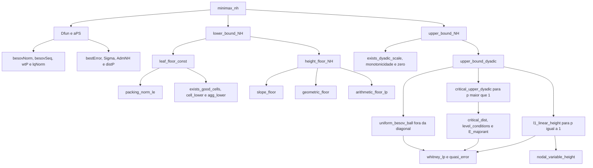

# F6 — Auditoria independente do Teorema 5.2

## 1. Parecer e identificação

**A — Certificação formal e semântica aprovada.** No commit auditado, `FormalizacaoMinimax.minimax_nh` demonstra as duas desigualdades do Teorema 5.2 para a mesma bola unitária de Besov e a mesma biblioteca racional diádica, com constantes positivas uniformes e orçamentos independentes. A reprodução e as consultas transitivas passaram com os três axiomas padrão. A auditoria registrou três problemas menores de documentação e uma observação sobre um lema auxiliar.

A referência auditada é o rótulo `lp:thm:minimax-nh` do manuscrito **Lei minimax para aproximação de Besov com folhas diádicas e altura aritmética**, título que consta da fonte congelada. O enunciado comparece em [conjecturas_lp.tex, linhas 884–902](https://github.com/Walc21/ARTIGO-BESOV/blob/19c85be8bd08098b4a8c6d0452e755b5e3683be7/conjecturas_lp.tex#L884), e a declaração em [MinimaxFinal.lean, linha 64](https://github.com/Walc21/ARTIGO-BESOV/blob/19c85be8bd08098b4a8c6d0452e755b5e3683be7/lean4/formalizacao/Formalizacao/MinimaxFinal.lean#L64).

| Referência Git observada antes do checkout | SHA |
|---|---|
| `HEAD`, `formalizacao-teorema-5-2` e `origin/formalizacao-teorema-5-2` | `19c85be8bd08098b4a8c6d0452e755b5e3683be7` |
| `main` e `origin/main` | `36192a75fc8c0b4f26e4690c5778357a8aea4874` |
| `pesquisa-minimax-altura` e `origin/pesquisa-minimax-altura` | `f02baea6faffd563ddf7877548b59827854dea1e` |
| Tag anotada `editorial-v1.0` | objeto `0e0972df148bc94973292e3e1775f319c6876c0c`, commit `f02baea6faffd563ddf7877548b59827854dea1e` |

O remoto configurado é `https://github.com/Walc21/ARTIGO-BESOV.git`. Os valores de `origin/*` são referências locais de rastreamento. A auditoria usou um clone local independente, em detached HEAD no SHA acima, com a árvore de fontes limpa. As linhas citadas referem-se a esse commit. Os experimentos ficam fora da cópia congelada.

Foram examinados o manuscrito integral, os relatórios F1–F5, o mapa LaTeX–Lean e os testes versionados. Os relatórios anteriores serviram à localização dos resultados e à comparação histórica. O parecer se apoia nas provas, nas definições e nas execuções independentes documentadas abaixo.

## 2. Ambiente e reprodução

Ubuntu 26.10 x86_64, kernel Linux 7.3.0-10-generic, Git 2.55.0 e Python 3.14.8. Lean 4.28.0 Release, commit `7e01a1bf5c70fc6167d49c345d3bf80596e9a79b`, e Lake 5.0.0-src+7e01a1b. O alvo padrão do `lakefile.toml` é `Formalizacao`. O manifesto fixa nove dependências, restauradas dos objetos Git, sem copiar diretórios de compilação do checkout original.

| Dependência | Commit fixado |
|---|---|
| Mathlib v4.28.0 | `8f9d9cff6bd728b17a24e163c9402775d9e6a365` |
| plausible | `55c8532eb21ec9f6d565d51d96b8ca50bd1fbef3` |
| LeanSearchClient | `c5d5b8fe6e5158def25cd28eb94e4141ad97c843` |
| importGraph | `85b59af46828c029a9168f2f9c35119bd0721e6e` |
| proofwidgets | `be3b2e63b1bbf496c478cef98b86972a37c1417d` |
| aesop | `f642a64c76df8ba9cb53dba3b919425a0c2aeaf1` |
| Qq | `b8f98e9087e02c8553945a2c5abf07cec8e798c3` |
| batteries | `495c008c3e3f4fb4256ff5582ddb3abf3198026f` |
| Cli | `4f10f47646cb7d5748d6f423f4a07f98f7bbcc9e` |

Sequência executada. Em cada dependência, o checkout ficou no SHA do manifesto e `git status --porcelain` saiu vazio.

```bash
git clone --no-local --no-checkout . "$copia_f6"
git -C "$copia_f6" switch --detach 19c85be8bd08098b4a8c6d0452e755b5e3683be7
cd "$copia_f6/lean4/formalizacao"
lean --version
lake --version
# Para cada dependência do manifesto, a partir dos respectivos objetos Git locais
git clone --no-hardlinks --local --no-checkout "$fonte_git" ".lake/packages/$nome"
git -C ".lake/packages/$nome" remote set-url origin "$url_do_manifesto"
git -C ".lake/packages/$nome" switch --detach "$sha_do_manifesto"
MATHLIB_CACHE_DIR="$evidencias_f6/cache-download" lake exe cache get
export LEAN_NUM_THREADS=4
lake build Formalizacao
lake build RequestProject Pendencias
lake env lean Formalizacao/Auditoria.lean
lake env lean ../../testes/Minimax52.lean
lake env lean "$evidencias_f6/DeclaracoesF6.lean"
lake env lean "$evidencias_f6/SemanticaF6.lean"
cd ../..
python3 -B -m unittest discover -s testes -v
python3 -B mapas/verificar_mapa.py
```

O clone local com hardlinks falhou por cruzar pontos de montagem. A opção `--no-hardlinks` permitiu restaurar os fontes. A primeira tentativa de baixar a Mathlib encontrou bloqueio de DNS no sandbox. A repetição com acesso à rede baixou do cache público da Mathlib os 8.010 artefatos solicitados, com diretório de cache próprio. Esses artefatos pertencem às dependências. A contagem em `.lake/build` do projeto, imediatamente antes de `lake build Formalizacao`, foi **zero arquivos `.olean`**.

## 3. Compilação e testes de reprodução

| Comando | Resultado observado | Evidência |
|---|---|---|
| `lake exe cache get` | 0, cache novo dos pacotes fixados | [Log do cache](evidencias/F6-19c85be/cache.log) |
| `lake build Formalizacao` | 0, 8.140 jobs. Recompilou o alvo e os módulos locais importados | [Log de compilação](evidencias/F6-19c85be/build.log) |
| `lake build RequestProject Pendencias` | 0, 8.112 jobs. Verificou os outros dois alvos do `lakefile.toml` | [Log dos alvos complementares](evidencias/F6-19c85be/build-completo.log) |
| `lake env lean Formalizacao/Auditoria.lean` | 0, 239 consultas a 234 declarações distintas. Saída idêntica ao registro congelado | [Log da auditoria de axiomas](evidencias/F6-19c85be/axiomas-auditoria.log) |
| `lake env lean ../../testes/Minimax52.lean` | 0, seis pares $(p,s)$ em $q=1/2$ e $q=\infty$, limiar diádico e monotonicidade de orçamentos | [Log do teste Lean](evidencias/F6-19c85be/minimax52-antecipado.log) |
| `python3 -B -m unittest discover -s testes -v` | 0, 9 testes passaram | [Log dos testes Python](evidencias/F6-19c85be/unittest.log) |
| `python3 -B mapas/verificar_mapa.py` | 0, 64 entradas e 267 referências a nomes aceitas, mapa atualizado | [Log do mapa](evidencias/F6-19c85be/mapa-antecipado.log) |
| `lake env lean "$evidencias_f6/DeclaracoesF6.lean"` | 0, sete consultas transitivas e extração do grafo | [Log dos sete alvos e do grafo](evidencias/F6-19c85be/declaracoes-antecipado.log) |
| `lake env lean "$evidencias_f6/SemanticaF6.lean"` | 0, provas e exemplos adversariais aceitos | [Log do teste semântico](evidencias/F6-19c85be/semantica-previa.log) |

O alvo principal emitiu 90 avisos, incluindo depreciações de lemas, variáveis e argumentos de `simp` sem uso. `MinimaxDefs`, `Packing`, `LeafFloor`, `NodalVariable`, `L1LinearHeight`, `MinimaxUpper` e `MinimaxFinal` foram compilados sem avisos próprios. Os alvos complementares registraram 36 avisos, incluindo avisos reproduzidos de módulos compartilhados. Ambos os builds terminaram sem erros.

A primeira chamada ao verificador do mapa, durante a preparação, retornou `unknown module prefix 'Formalizacao'` porque a biblioteca do projeto ainda não havia sido compilada. A execução declarada na tabela usa o resultado do build independente.

## 4. Axiomas e integridade

Os sete alvos receberam consultas novas de `#print axioms`, em um arquivo que importa diretamente `Formalizacao.MinimaxFinal`. O arquivo `Auditoria.lean` do repositório foi executado em separado.

| Declaração | Local |
|---|---|
| `FormalizacaoMinimax.minimax_nh` | [MinimaxFinal.lean:64](https://github.com/Walc21/ARTIGO-BESOV/blob/19c85be8bd08098b4a8c6d0452e755b5e3683be7/lean4/formalizacao/Formalizacao/MinimaxFinal.lean#L64) |
| `FormalizacaoMinimax.lower_bound_NH` | [MinimaxFinal.lean:35](https://github.com/Walc21/ARTIGO-BESOV/blob/19c85be8bd08098b4a8c6d0452e755b5e3683be7/lean4/formalizacao/Formalizacao/MinimaxFinal.lean#L35) |
| `FormalizacaoMinimax.upper_bound_NH` | [MinimaxUpper.lean:212](https://github.com/Walc21/ARTIGO-BESOV/blob/19c85be8bd08098b4a8c6d0452e755b5e3683be7/lean4/formalizacao/Formalizacao/MinimaxUpper.lean#L212) |
| `FormalizacaoMinimax.upper_bound_dyadic` | [MinimaxUpper.lean:166](https://github.com/Walc21/ARTIGO-BESOV/blob/19c85be8bd08098b4a8c6d0452e755b5e3683be7/lean4/formalizacao/Formalizacao/MinimaxUpper.lean#L166) |
| `FormalizacaoMinimax.critical_upper_dyadic` | [MinimaxUpper.lean:64](https://github.com/Walc21/ARTIGO-BESOV/blob/19c85be8bd08098b4a8c6d0452e755b5e3683be7/lean4/formalizacao/Formalizacao/MinimaxUpper.lean#L64) |
| `FormalizacaoAltura.nodal_variable_height` | [NodalVariable.lean:295](https://github.com/Walc21/ARTIGO-BESOV/blob/19c85be8bd08098b4a8c6d0452e755b5e3683be7/lean4/formalizacao/Formalizacao/NodalVariable.lean#L295) |
| `FormalizacaoAltura.l1_linear_height` | [L1LinearHeight.lean:149](https://github.com/Walc21/ARTIGO-BESOV/blob/19c85be8bd08098b4a8c6d0452e755b5e3683be7/lean4/formalizacao/Formalizacao/L1LinearHeight.lean#L149) |

Cada um dos sete comandos retornou exatamente `[propext, Classical.choice, Quot.sound]`. A união de axiomas não padrão é vazia, com **zero axiomas adicionais e zero `sorryAx`**. A extração do fechamento também encontrou zero declarações locais do tipo `axiom` ou `opaque`.

A execução de `Formalizacao/Auditoria.lean` fez **239 consultas a 234 declarações distintas**. Todas retornaram o conjunto padrão. `cmp` confirmou igualdade byte a byte com `lean4/formalizacao/auditoria_axiomas.txt`. Ambas as saídas têm SHA-256 `9f6dd01bfcb9124dd9becfdd6f5e9cce498a8e460726de8ffa773ee3ba7b11f9`.

A inspeção textual abrangeu as fontes Lean versionadas, incluindo `Pendencias/` e `RequestProject/`. Os usos textuais de `sorry` e `sorryAx` nesses módulos são comentários. A busca cobriu também `admit`, declaração de `axiom` ou `opaque`, `native_decide`, `Lean.ofReduceBool` e opções de supressão de checagem do kernel. O nome do arquivo `LpAxioms.lean` refere-se às propriedades do módulo de suavidade, provadas ali, como subaditividade, monotonicidade e a cota por quatro vezes a norma.

Para investigar circularidade e enfraquecimento, foram examinadas as definições transparentes de `Dfun`, `bestError`, `Sigma`, `besovNorm` e `AdmNH`, as hipóteses das duas cotas e a origem de `WhitneyLp p CW`. As construções escolhem alvos ou aproximantes explícitos. As propriedades de admissibilidade e de pertencer à bola são estabelecidas em lemas independentes da desigualdade final. Todo uso de Whitney no caminho do Teorema 5.2 vem da prova `whitney_lp`.

## 5. Grafo de dependências

Na figura, cada aresta indica uma dependência direta ou um caminho com lemas intermediários omitidos. A tabela da seção 7 explicita esses caminhos.



O grafo foi extraído do ambiente de kernel reconstruído. Para cada constante visitada, o extrator percorreu as referências em seu tipo e corpo e incluiu os construtores de tipos indutivos. O fechamento de `minimax_nh` alcançou **47.167 constantes** incluindo Lean e dependências, das quais **794 declarações locais** em **68 módulos**, com **3.042 arestas locais**. Os outros seis alvos já pertencem ao mesmo fechamento. A inspeção dos imports encontra 100 módulos locais, dos quais 70 em `Formalizacao`, 20 em `RequestProject` e 10 em `Pendencias`. O fechamento de declarações de fato referencia, respectivamente, 59, 6 e 3 módulos dessas bibliotecas. [Extrator Lean](evidencias/F6-19c85be/DeclaracoesF6.lean), [imports locais](evidencias/F6-19c85be/imports.tsv), [declarações](evidencias/F6-19c85be/declaracoes.tsv), [arestas](evidencias/F6-19c85be/arestas.tsv), [módulos](evidencias/F6-19c85be/modulos.tsv).

O erro uniforme `Artigo.jointErr`, os predicados `HypJp` e `HypJpStrong` e as declarações `critical_level`, `critical_lq` e `critical_rate` ficam fora do fechamento. Isso descarta, para este teorema, as dependências de alvos individuais e as restrições de somabilidade de alguns resultados vizinhos. O uso de `RequestProject.JointBudget` limita-se a `AdmNH` e aos lemas aritméticos `ht_cast_le_of` e `natAbs_cast_le`. Os módulos de `Pendencias` no fechamento fornecem definições e lemas, incluindo `Sigma` e partes da quantização racional.

## 6. Matriz LaTeX–Lean

| Objeto ou condição do manuscrito | Representação Lean no fechamento | Verificação independente |
|---|---|---|
| Alvos sobre `[0,1]`, Lebesgue | `FormalizacaoLp.vol01` em [LpDefs.lean:23](https://github.com/Walc21/ARTIGO-BESOV/blob/19c85be8bd08098b4a8c6d0452e755b5e3683be7/lean4/formalizacao/Formalizacao/LpDefs.lean#L23) | `volume.restrict (Icc 0 1)`. A massa total é 1. Restrições e translações mantêm as avaliações relevantes no intervalo. |
| `Δ²_h f` | `FormalizacaoLp.diff2` em [LpDefs.lean:26](https://github.com/Walc21/ARTIGO-BESOV/blob/19c85be8bd08098b4a8c6d0452e755b5e3683be7/lean4/formalizacao/Formalizacao/LpDefs.lean#L26) | Mesmos pontos, sinais e pesos `1, −2, 1`. |
| `ω_p(f,t)` | `FormalizacaoLp.wtP` em [LpDefs.lean:30](https://github.com/Walc21/ARTIGO-BESOV/blob/19c85be8bd08098b4a8c6d0452e755b5e3683be7/lean4/formalizacao/Formalizacao/LpDefs.lean#L30) | Usa `Ioc 0 (min t (1/2))`. Para cada passo a norma é sobre `Icc 0 (1−2h)`. Em `h=1/2` o conjunto de integração é um singleton nulo. |
| Sequência `2^{rs} ω_p(f,2^{-r})` | `FormalizacaoRed.besovSeq` em [Reductions.lean:24](https://github.com/Walc21/ARTIGO-BESOV/blob/19c85be8bd08098b4a8c6d0452e755b5e3683be7/lean4/formalizacao/Formalizacao/Reductions.lean#L24) | `r : ℕ`, incluindo 0. Usa potência real para o peso e `1 / 2^r` para a escala. |
| `0<q<1` e `1≤q<∞` | `FormalizacaoLp.lqNorm` em [LpDefs.lean:44](https://github.com/Walc21/ARTIGO-BESOV/blob/19c85be8bd08098b4a8c6d0452e755b5e3683be7/lean4/formalizacao/Formalizacao/LpDefs.lean#L44) | Soma dos termos elevados a `q.toReal`, seguida da potência inversa. Todo `q` finito positivo produz um expoente estritamente positivo. |
| `q=∞` | Ramo `q = ⊤` de `lqNorm` | Supremo dos termos. `toReal ⊤ = 0` fica fora desse ramo. |
| Quase-norma e bola unitária | `FormalizacaoLow.besovNorm` e `Dfun` em [UnifSup.lean:23](https://github.com/Walc21/ARTIGO-BESOV/blob/19c85be8bd08098b4a8c6d0452e755b5e3683be7/lean4/formalizacao/Formalizacao/UnifSup.lean#L23) e [MinimaxDefs.lean:28](https://github.com/Walc21/ARTIGO-BESOV/blob/19c85be8bd08098b4a8c6d0452e755b5e3683be7/lean4/formalizacao/Formalizacao/MinimaxDefs.lean#L28) | Soma da norma `L^p` e da quase-norma da sequência com limite inclusivo 1. A desigualdade implica finitude das duas parcelas. |
| Classes quase em toda parte | `Measurable f` em `Dfun`, invariância sob `=ᵐ[vol01]` | Cada classe tem representante global mensurável. A quase-norma e o melhor erro são invariantes. Demonstração abaixo. |
| Segmento `u+v(x−x_{k,m})` | `Artigo.Atom` e `Atom.eval` em [Atoms.lean:17](https://github.com/Walc21/ARTIGO-BESOV/blob/19c85be8bd08098b4a8c6d0452e755b5e3683be7/lean4/formalizacao/RequestProject/Atoms.lean#L17) | `y0,s : ℚ`, certificado `s≠0`, centro `(2m+1)/2^{k+1}`. A inclinação é a do eixo físico `x`. |
| Altura reduzida de cada átomo | `Artigo.ht` e `Atom.height` em [Indexing.lean:129](https://github.com/Walc21/ARTIGO-BESOV/blob/19c85be8bd08098b4a8c6d0452e755b5e3683be7/lean4/formalizacao/RequestProject/Indexing.lean#L129) e [Atoms.lean:45](https://github.com/Walc21/ARTIGO-BESOV/blob/19c85be8bd08098b4a8c6d0452e755b5e3683be7/lean4/formalizacao/RequestProject/Atoms.lean#L45) | `Rat.num` e `Rat.den` são canônicos, com denominador positivo. A altura combina `2,k+1,m.natAbs+1,ht(y0),ht(s)` por máximo. |
| Geometria, continuidade e orçamentos | `LTree.WF`, `LTree.eval`, `LTree.maxHeight`, `AdmNH` e `classNH` em [Trees.lean:98](https://github.com/Walc21/ARTIGO-BESOV/blob/19c85be8bd08098b4a8c6d0452e755b5e3683be7/lean4/formalizacao/RequestProject/Trees.lean#L98), [JointBudget.lean:27](https://github.com/Walc21/ARTIGO-BESOV/blob/19c85be8bd08098b4a8c6d0452e755b5e3683be7/lean4/formalizacao/RequestProject/JointBudget.lean#L27) e [LpDefs.lean:64](https://github.com/Walc21/ARTIGO-BESOV/blob/19c85be8bd08098b4a8c6d0452e755b5e3683be7/lean4/formalizacao/Formalizacao/LpDefs.lean#L64) | Bisseções completas desde `(0,0)`, dois filhos por nó interno, acordo exato dos extremos, número de folhas `≤N` e máximo das alturas `≤H`. Equivalência por restrição e conversão abaixo. |
| `Σ_{N,H} = {0} ∪ 𝒜_{N,H}` | `Pendencias.Agenda.Sigma (fun _ ↦ H) N` em [Agenda.lean:24](https://github.com/Walc21/ARTIGO-BESOV/blob/19c85be8bd08098b4a8c6d0452e755b5e3683be7/lean4/formalizacao/Pendencias/Agenda.lean#L24) | União definicional. A agenda constante é um meio de passar `H` ao conjunto e impõe somente a altura do par dado. |
| `e^H_{N,p}(f)` | `FormalizacaoFloor.bestError` e `distP` em [ArithmeticFloor.lean:145](https://github.com/Walc21/ARTIGO-BESOV/blob/19c85be8bd08098b4a8c6d0452e755b5e3683be7/lean4/formalizacao/Formalizacao/ArithmeticFloor.lean#L145) e [LpDefs.lean:35](https://github.com/Walc21/ARTIGO-BESOV/blob/19c85be8bd08098b4a8c6d0452e755b5e3683be7/lean4/formalizacao/Formalizacao/LpDefs.lean#L35) | Ínfimo da norma `L^p` da diferença. A função zero dá uma cota finita para cada alvo elegível. |
| `D_{p,s,q}(N,H)` | `FormalizacaoMinimax.Dfun` em [MinimaxDefs.lean:28](https://github.com/Walc21/ARTIGO-BESOV/blob/19c85be8bd08098b4a8c6d0452e755b5e3683be7/lean4/formalizacao/Formalizacao/MinimaxDefs.lean#L28) | Supremo sobre os valores do melhor erro de toda a bola. Os índices adicionais são provas de mensurabilidade e de pertença à bola. Os supremos vazios desses índices contribuem com zero. |
| `a(p,s)`, parâmetros e uniformidade | `aPS`, `aPS_eq_nuHat` e `minimax_nh` em [MinimaxDefs.lean:22](https://github.com/Walc21/ARTIGO-BESOV/blob/19c85be8bd08098b4a8c6d0452e755b5e3683be7/lean4/formalizacao/Formalizacao/MinimaxDefs.lean#L22) e [MinimaxFinal.lean:64](https://github.com/Walc21/ARTIGO-BESOV/blob/19c85be8bd08098b4a8c6d0452e755b5e3683be7/lean4/formalizacao/Formalizacao/MinimaxFinal.lean#L64) | Os testes são `s<1/p` e `s≤1`, nessa ordem. `s=1/p` e `s=1` estão na faixa central, inclusive quando coincidem. `p,s : ℝ` com `1≤p` e `0<s<2`, `q : ENNReal` com `0<q`. Os reais positivos `c,C` são escolhidos antes de `N,H : ℕ`, com limites inferiores separados `2≤N` e `2≤H`. |

### Representantes e igualdade exata do supremo

Para $h$ admissível, $I_h=[0,1-2h]$ e cada translação $x\mapsto x+c$, $c\in\{0,h,2h\}$, levam $I_h$ a $[0,1]$. A pré-imagem do conjunto nulo onde dois representantes divergem tem medida nula, por invariância da Lebesgue por translação. A união das três pré-imagens, **para cada $h$ fixo**, estabelece a igualdade quase em toda parte das diferenças em $I_h$. Portanto cada termo do supremo tem a mesma norma. Isso evita uma união não enumerável de excepcionais. A invariância da norma do alvo e de `distP` segue da restrição da medida, e a de `bestError` segue tomando o mesmo ínfimo. Para uma função Lebesgue-mensurável em $[0,1]$, estender por zero dá uma função mensurável para a medida completada. Para alvos reais, `NullMeasurable.aemeasurable` na Mathlib liga a mensurabilidade na medida completada à existência de um representante Borel. A escolha `AEMeasurable.mk` realiza esse representante global na mesma classe. A restrição e essa escolha de representante preservam a bola de raio 1 e o conjunto de valores do erro.

### Equivalência da biblioteca por restrição a `[0,1]`

Em uma folha, `WF` confere o endereço inscrito no átomo com o endereço determinado pela recursão. Em um nó, os filhos de `(k,m)` são `(k+1,2m)` e `(k+1,2m+1)`, formando dois intervalos fechados com interseção no ponto médio. Embora `m` tenha tipo inteiro, a recursão desde `(0,0)` garante $0\le m<2^k$ em todos os endereços. Os extremos externos são herdados, e `l.rval = r.lval` cola as duas avaliações no ponto médio. Indução dá a cobertura sem sobreposição de interiores. `eval_leaf` mostra igualdade com o átomo **em toda a folha fechada**, inclusive quando `eval` atribui o ponto médio ao ramo direito. Isso dá uma função contínua por colagem finita, também confirmada por `classNH_lipschitz`. Na direção inversa, da representação do manuscrito, cada bisseção vira um `node` e cada folha um `Atom` com o mesmo `k,m,u,v`. A coincidência dos extremos produz exatamente `WF`. A lista de folhas e o máximo das alturas são preservados. As avaliações Lean prolongam a primeira e a última retas para fora de $[0,1]$, e a restrição de toda avaliação admissível recupera a função do manuscrito. O ínfimo depende exclusivamente dessas restrições. [Lemas de avaliação e cobertura](https://github.com/Walc21/ARTIGO-BESOV/blob/19c85be8bd08098b4a8c6d0452e755b5e3683be7/lean4/formalizacao/RequestProject/Trees.lean#L185), [continuidade via Lipschitz](https://github.com/Walc21/ARTIGO-BESOV/blob/19c85be8bd08098b4a8c6d0452e755b5e3683be7/lean4/formalizacao/Formalizacao/AlturaTerminal.lean#L221).

### Valores estendidos e transferências numéricas

Para $p\ge1$, `ENNReal.ofReal p` é finito, positivo e recupera $p$ via `toReal`. Nessa faixa, `eLpNorm (f - g) (ENNReal.ofReal p) vol01` é a potência $1/p$ da integral de $\lvert f-g\rvert^p$ em $[0,1]$. O melhor erro está em $[0,\Vert f\Vert _p]$ porque a classe contém zero. O alvo zero pertence à bola, e o supremo coincide com o supremo real desses valores em $[0,1]$ após a imersão em `ENNReal`. As cotas reais têm bases $N,H\ge2$, expoente $a(p,s)>0$ e constantes estritamente positivas, portanto `ofReal` preserva sua ordem sem truncamento. Os usos de `toReal` em cotas auxiliares partem de finitude garantida por `ball_bounds`, `wtP_lt_top` ou pela finitude explícita da expressão convertida. [Cotas da bola](https://github.com/Walc21/ARTIGO-BESOV/blob/19c85be8bd08098b4a8c6d0452e755b5e3683be7/lean4/formalizacao/Formalizacao/UnifSup.lean#L42), [positividade do expoente](https://github.com/Walc21/ARTIGO-BESOV/blob/19c85be8bd08098b4a8c6d0452e755b5e3683be7/lean4/formalizacao/Formalizacao/MinimaxDefs.lean#L46).

## 7. Reconstrução das provas matemáticas

### Cotas inferiores

| Passo Lean e fonte matemática | Hipóteses e dependências | Verificação |
|---|---|---|
| `packing_norm_le`, condição de normalização do lema de empacotamento (TeX 793–844) | $p\ge1$, $0<s<2$, $q>0$, bump fixo, $m\ge1$. `Packing.lean:337,541,601` e `AlturaFloor.lean:24–141`. | Em cada ponto, no máximo um bump da soma original é ativo. Em sua segunda diferença, as três avaliações dão sobreposição ≤3. O fator $1/m$ do jacobiano cancela o número de células na soma integral. Com `exists_K0`, o módulo é limitado por $K_0\vert A\vert \min(1,(mt)^2)$. Para $A=b m^{-s}$, as duas caudas em torno de `Nat.log 2 m` decaem com expoentes $s$ e $2-s$. Para $q<\infty$, somam-se potências positivas, e para $q=\infty$, toma-se o supremo. Com $b=1/(1+L)$, o termo $L^p$ mais a contribuição da sequência é no máximo 1. A prova serve ao vetor de bits todo 1. |
| `exists_good_cells`, `cell_lower`, `agg_lower` e `leaf_floor_const` (TeX 864–882) | Para todo `g∈Sigma`, leitura de `AdmNH` e `WF`. `LeafFloor.lean:20–164,258,341,380,433`. | Uma árvore binária de $N'$ folhas tem no máximo $N'-1$ pontos de divisão distintos. Cada um atinge o interior de no máximo uma das $2N$ células de teste. Um ponto de divisão no extremo deixa válidos ambos os interiores adjacentes. Em ao menos $N$ células, a recursão de avaliação segue um único ramo até uma folha. Integração por partes anula a reta contra `φB''` e dá `−∫(φB')²` para o bump. Após a mudança de escala, Hölder com `L¹` e medida da célula dá piso $A\kappa/M\cdot m^{-1/p}$ em cada célula, inclusive em $p=1$. A soma das potências $p$ dá pelo menos $A\kappa/(2M)$ em norma, usando $2^{1/p}\le2$. O alvo depende de $N$ e serve para toda altura e para o aproximante zero. |
| `slope_floor` e `dfun_slope_floor` (TeX 762–777) | $0<s\le1/p$, $H\ge2$, escala de bump em `AlturaBesov.lean:252`, Lipschitz em `AlturaTerminal.lean:221`, separação em `AlturaSlope.lean:23,158,250`, ponte em `LeafFloor.lean:478`. | A altura domina o valor absoluto da inclinação. Colando folhas, a variação de $g$ entre $x$ e $x+t$ fica limitada por $Ht$. Com `δ=1/p−s`, a amplitude $a=c t^{-\delta }$ e $t=(c/(2H))^{1/(1+\delta )}$ garantem $Ht=a/2$ e norma de Besov ≤1. O alvo tem valor $a$ num subintervalo do platô e 0 no transladado, ambos no domínio. Somar os erros nas duas posições e integrar dá $a t^{1/p}\asymp H^{-s/(1+\delta )}$. |
| `geometric_floor` e `dfun_geometric_floor` (TeX 747–759) | $0<s<2$, $H\ge2$, `terminal_affine`, `geometric_dist_lower`, normalização do bump e ponte de ínfimo/supremo. [AlturaFloor.lean:363](https://github.com/Walc21/ARTIGO-BESOV/blob/19c85be8bd08098b4a8c6d0452e755b5e3683be7/lean4/formalizacao/Formalizacao/AlturaFloor.lean#L363), [LeafFloor.lean:466](https://github.com/Walc21/ARTIGO-BESOV/blob/19c85be8bd08098b4a8c6d0452e755b5e3683be7/lean4/formalizacao/Formalizacao/LeafFloor.lean#L466). | A folha terminal direita tem $m=2^k-1$. O campo de endereço impõe $2^k\le H$, logo a folha contém $[1-1/H,1]$, mesmo em árvore adaptativa. Para $t=1/H$, o bump de amplitude $t^{s-1/p}/\Lambda$ está na bola e separa-se de toda reta nesse intervalo por um múltiplo positivo de $t^s$. |
| `arithmetic_floor_lp` e `dfun_arithmetic_floor` (TeX 673–688) | $p\ge1$, $H\ge1$ no piso. Átomos, integração nas folhas, `tree_floor`, volume unitário e comparação de normas. [ArithmeticFloor.lean:130](https://github.com/Walc21/ARTIGO-BESOV/blob/19c85be8bd08098b4a8c6d0452e755b5e3683be7/lean4/formalizacao/Formalizacao/ArithmeticFloor.lean#L130), [LeafFloor.lean:496](https://github.com/Walc21/ARTIGO-BESOV/blob/19c85be8bd08098b4a8c6d0452e755b5e3683be7/lean4/formalizacao/Formalizacao/LeafFloor.lean#L496). | O alvo constante $1/(2H)$ tem módulo zero e pertence à bola para $H\ge2$. O valor central é a média da função afim na folha. Um racional positivo de altura ≤$H$ é ≥$1/H$. Por isso a diferença da média tem módulo ≥$1/(2H)$ para todo sinal do valor central. A desigualdade integral em $L^1$ sobre folhas e $\Vert \cdot\Vert _1\le\Vert \cdot\Vert _p$ em medida de probabilidade substituem a aplicação direta de Jensen a `\|·\|^p` usada no texto. O candidato zero atinge o piso para esse alvo. |
| `height_floor_NH` e `lower_bound_NH` (TeX 905) | As três pontes anteriores e `leaf_floor_const`. [MinimaxFinal.lean:17](https://github.com/Walc21/ARTIGO-BESOV/blob/19c85be8bd08098b4a8c6d0452e755b5e3683be7/lean4/formalizacao/Formalizacao/MinimaxFinal.lean#L17). | A análise por faixa de `aPS` escolhe os pisos de inclinação, geométrico e aritmético. O mesmo supremo domina $c_N N^{-s}$ e $c_H H^{-s/a}$, ainda que os alvos sejam distintos. A cota inferior conjunta usa `min c_N c_H / 2`, escolhido antes dos orçamentos. |

### Cota superior

| Faixa | Altura suficiente em $n=2^r$ | Piso de altura |
|---|---|---|
| $0<s<1/p$ | $A n^{1+1/p-s}$ | Inclinação, $H^{-s/(1+1/p-s)}$ |
| $s=1/p$, $p>1$ | $A n$ | Geométrico, $H^{-1/p}$ |
| $p=s=1$ | $2C_E n$ | Geométrico, $H^{-1}$ |
| $1/p<s\le1$ | $A n$ | Geométrico, $H^{-s}$ |
| $1<s<2$ | $A n^s$ | Aritmético, $H^{-1}$ |

Em cada linha, o erro é $O(n^{-s})$ para todo $0<q\le\infty$. As cotas geométricas incluem as fronteiras $s=1/p$ e $s=1$. As afirmações aqui se referem ao melhor erro por escala e ao supremo minimax da Seção 5 do manuscrito.

| Passo e fonte matemática | Hipóteses e dependências | Verificação |
|---|---|---|
| Whitney, projeção local e quase-interpolação (TeX 205–340) | $p\ge1$, $n\ge2$, alvo mensurável, $L^p$ finito, integrabilidade nas células. `QuasiLocal`, `QuasiGrid`, `LocalError`, `Corollary54`, `Whitney0–13`. | Os núcleos nos extremos são $(4-6u)/\ell$ e $(6u-2)/\ell$. `lam` usa a célula à direita exceto no último nó, que usa o extremo direito da última célula. Os chapéus dão o interpolante afim dos coeficientes. Reprodução afim e Hölder produzem o fator 9 no erro local. Com `δ=1/(4n)`, Whitney usa primitivas para a média dupla, reflexão e Jensen no interior, Taylor para a reta tangente e translações nas faixas de borda. Tonelli e multiplicidade ≤4 convertem a soma dos erros locais no módulo global. `whitney_lp` constrói $C_W(p)$ e `quasi_error_unc` descarrega a hipótese `WhitneyLp`. |
| `lam_bound_unif`, `uniform_besov_ball` e `upper_dyadic_off_critical` (TeX 481–501, 907–909) | Bola de raio 1, $n=2^r$, $r\ge1$, $s\ne1/p$. `UnifSup.lean:138`, `UnifCore.lean:54`, `UnifTheorem.lean:205,287,315,409`, `MinimaxUpper.lean:132`. | Para $s<1/p$, a série das diferenças de quase-interpolantes tem soma $O(n^{1/p-s})$. Para $s>1/p$, a série converge geometricamente em sup, com cota nodal uniforme. O último fato em Lean controla diretamente os quase-interpolantes, enquanto o texto recorre ao representante contínuo. O orçamento usa `κ=0`, `kapHat=0` e `nuHat=aPS` fora da diagonal. `qexp` escolhe $Q\ge\max(n,n^s)$ até fator 2. Em `lp_jackson_low_core` e `nodal_tree_gen`, a grade de denominador comum alterna a paridade dos numeradores dos nós. O valor central tem denominador $4Q$, a inclinação tem denominador $2Q/n$, e a altura controla também o endereço. Os nós compartilhados dão `WF`. A quantização custa no máximo $1/(2Q)$ em $L^p$. |
| `critical_upper_dyadic` em $s=1/p,p>1$, incluindo $q=\infty$ (TeX 607–646, 911) | `term_le_lqNorm`, `wr_le_of_besov`, `critical_approx`, `critical_dist`, `level_conditions`, `E_majorant`, `poly_geom_majorant`. [MinimaxUpper.lean:64](https://github.com/Walc21/ARTIGO-BESOV/blob/19c85be8bd08098b4a8c6d0452e755b5e3683be7/lean4/formalizacao/Formalizacao/MinimaxUpper.lean#L64). | Cada coeficiente diádico é ≤1 na bola para todo $q>0$. Os saltos nodais têm cota uniforme, e a amplitude $M_r$ cresce no máximo linearmente em $r$. Com $n=2^r$, $r+1\le n$ e $2(n+1)\le3n$, a altura $H\ge\max(1,3\operatorname{Avc}) n$ satisfaz os três limiares de `critical_dist`. A quantização usa denominador comum diádico e distingue o caso em que a inclinação passa a ser inteira. O erro intermediário $O((r+2)/n)$, multiplicado por $n^{1/p}$, fica limitado por um múltiplo de $(r+2)\rho^r$, $\rho=2^{1/p-1}<1$. A constante depende de $p$ e de Whitney. A altura final é linear e a taxa é $n^{-1/p}$, inclusive no supremo $q=\infty$. |
| `nodal_variable_height` (TeX 446–465) | `r≥1`, `J≥0`, saltos $\le J$, $H\ge8w_j$ para cada nó e $H\ge n(J+4)$, com `w_j=1+J+\|y_j\|`. `NodalVariable.lean:16,26,87,222,295`. | Cada $Q_j$ satisfaz $8w_jQ_j\le H<16w_jQ_j$. Nos ímpares há três candidatos distintos e dois vizinhos pares a evitar. Os erros são ≤$2/Q_j\le2$ e ≤$32w_j/H$. Denominadores adjacentes dividem $D=\max(Q_j,Q_{j+1})$. Com $w=\min(w_j,w_{j+1})$, a cota do salto implica $\vert y_i\vert \le w$ nos dois extremos e numeradores de módulo ≤$3Dw$. O centro usa denominador $2D$. Para $D\ge n$, o denominador da inclinação é $D/n$. Para $D<n$, a inclinação é inteira de módulo ≤$n(J+4)$. A redução só diminui os limites. Os erros locais integrados pesam cada nó no máximo duas vezes, dando $32\sum_j w_j/(Hn)$. |
| `l1_linear_height` em $p=s=1$ (TeX 648–663, 911) | `abs_lam_le`, `nodal_l1_bounds`, `l1_nodal_jump`, `nodal_variable_height`, `whitney_lp`. [L1LinearHeight.lean:149](https://github.com/Walc21/ARTIGO-BESOV/blob/19c85be8bd08098b4a8c6d0452e755b5e3683be7/lean4/formalizacao/Formalizacao/L1LinearHeight.lean#L149). | A projeção em cada extremo é limitada por $4n\int_{I_{c(j)}} \vert f\vert $. A última célula entra duas vezes, logo $\sum \vert \lambda_j\vert \le8n\Vert f\Vert _1$ e $\max \vert \lambda_j\vert \le4nB$. O salto uniforme é $J=(32+576C_W)B$. As duas restrições do quantizador cabem em $C_E(B+1)n$. A média dos pesos é ≤$2(1+J)+8B$, dando $C_E(B+1)/H$ de erro adicional. Na bola unitária, $H\ge2C_E n$ leva a erro ≤$(9C_W+1)n^{-1}$. $C_E$ precede $q$, e o argumento inclui $0<q<1$ e $q=\infty$. |
| `upper_bound_NH` e `minimax_nh` (TeX 913–921) | `aPS_pos`, `exists_dyadic_scale`, `classNH_mono`, `sigma_const_mono` e `upper_bound_dyadic`. [MinimaxUpper.lean:195](https://github.com/Walc21/ARTIGO-BESOV/blob/19c85be8bd08098b4a8c6d0452e755b5e3683be7/lean4/formalizacao/Formalizacao/MinimaxUpper.lean#L195). | Com $Y=(H/A)^{1/a}$, $X=\min(N,Y)$, $X\ge2$ dá $X/2<n\le X$. Daí $n\le N$ e $An^a\le H$. Elevar a $-s$ inverte a ordem e $X^{-s}=\max(N^{-s},Y^{-s})\le N^{-s}+Y^{-s}$. Em $X<2$, $N\ge2$ força $Y<2$ e $1\le2^sY^{-s}$, suficiente para o erro de escolher zero. Usa-se $Y^{-s}=A^{s/a}H^{-s/a}$ com o mesmo $C$ nos dois ramos. |

## 8. Testes adversariais

O quantizador por nó recebe `y : ℕ → ℝ`. Os orçamentos e a soma do erro dependem somente dos dados de 0 a $n$. Qualquer vetor de $n+1$ coordenadas admite essa representação por extensão. A hipótese `hu` identifica o interpolante nos intervalos fechados que cobrem $[0,1]$, de modo que a medição do erro dispensa hipóteses sobre os valores de `u` fora desse intervalo. [NodalVariable.lean:295](https://github.com/Walc21/ARTIGO-BESOV/blob/19c85be8bd08098b4a8c6d0452e755b5e3683be7/lean4/formalizacao/Formalizacao/NodalVariable.lean#L295).

O arquivo separado [SemanticaF6.lean](evidencias/F6-19c85be/SemanticaF6.lean) foi conferido pelo Lean. Ele prova a invariância de `wtP`, `besovNorm` e `bestError`, a existência de representante Borel com os mesmos valores e a igualdade de `Dfun` com o supremo que usa `AEMeasurable`. Também prova a igualdade da classe apontada com a união por zero, a existência de um átomo em `classNH 2 2`, a rejeição de dois filhos descontínuos e da altura 1 para uma folha, o valor da altura reduzida de $\pm 6/8$, as decisões na fronteira da bola e o valor exato de `bestError` em $L^1$ para o alvo aritmético. As cinco declarações auxiliares que receberam `#print axioms` usaram apenas os três axiomas padrão.

Os testes Python exercitam integridade editorial e o algoritmo do quantizador por nó com frações exatas, incluindo igualdade de limiar, mudança de denominador, $D<n$, $D=n$, $D>n$ e 600 vetores pseudoaleatórios com semente fixa. Os testes Lean do repositório instanciam as cotas e conferem expoentes. A igualdade semântica acima usa as definições e as provas de representação, além desses testes.

| Tentativa | Resultado da revisão |
|---|---|
| `Sigma` vazia ou apenas zero no menor orçamento | `Sigma` contém zero e uma única folha com centro 0 e inclinação 1, de altura 2, testemunha `classNH 2 2`. |
| Candidatos não contínuos, folha de inclinação nula, lacuna junto a 1 | `WF` rejeita dois filhos que discordam no ponto médio. `Atom` exige `s≠0`. `exists_leaf_mem` e `eval_leaf` cobrem os pontos de fronteira e a folha terminal. Uma constante não nula seria constante numa folha de comprimento positivo, em conflito com `s≠0`. |
| Altura de apresentação de fração confundida com altura canônica | `ht(6/8)=ht(-6/8)=4`. A altura da folha considera a fração reduzida do valor central e da inclinação. Uma grade temporária com denominador diferente serve apenas à estimativa. |
| Equivalência quase em toda parte, inclusive alterações no extremo | As translações de conjuntos nulos preservam o módulo para todo passo elegível. Trocar valores em 0, 1 ou em qualquer conjunto nulo preserva quase-norma e `bestError`. |
| Finitude mascarada por `toReal ⊤` ou $0\cdot\infty$ | A bola força a norma $L^p$ finita. O módulo é ≤$4\Vert f\Vert _p$. O ramo $q=\infty$ usa supremo, todo peso diádico é finito e positivo, e zero demonstra `Dfun≤1`. |
| $H\$ pequeno com $N$ arbitrariamente grande, ou $N$ pequeno com $H$ arbitrariamente grande | Para $X<2$, a segunda parcela cobre o erro trivial. Se $X\ge2$, a escolha de $n$ respeita os dois limites separadamente. A cota de altura independe de $N$ e a de folhas independe de $H$. |
| Fronteiras $s=0,1/p,1,2$, $p=1$, $q=0,\infty$ | $s=0,2$ e $q=0$ estão excluídos pelo próprio enunciado. $p=1$ e os dois extremos da faixa central estão incluídos. Em $s=1/p$ a cota superior é crítica, e o piso geométrico aplica-se. A condição $p>1$ para `ρ<1` é descarregada antes do uso. |
| Sup sobre uma bola meramente homogênea ou sobre alvos contínuos | A constante 1 pertence à bola, enquanto a constante 2 fica fora apesar de módulo zero. O domínio de `Dfun` inclui todos os representantes mensuráveis elegíveis. Mesmo quando o alvo é descontínuo, a cota superior usa integrais de células e vale para sua classe. |

## 9. Achados classificados

### F6-01 — Menor. Estado da formalização desatualizado nas edições do artigo

**Enunciado envolvido.** A lei minimax do melhor erro e os dois resultados auxiliares de quantização e altura crítica.

O resumo português e o apêndice ainda descrevem a lei minimax e o quantizador por nó como carentes de certificação. A edição inglesa repete essa descrição. O mapa M3–M5 já aponta para os resultados pertinentes. A consequência é uma informação pública incorreta sobre o alcance da versão. Recomenda-se registrar a certificação do melhor erro, da quantização por nó e da cota linear por escala nos dois pontos críticos, com as respectivas declarações. O corolário para realização e as afirmações globais sobre agendas e raio precisam de rastreabilidade própria. A linha 1484 também registra a contagem antiga de consultas. [Resumo e apêndice em português](https://github.com/Walc21/ARTIGO-BESOV/blob/19c85be8bd08098b4a8c6d0452e755b5e3683be7/conjecturas_lp.tex#L17), [parágrafo de escopo do apêndice](https://github.com/Walc21/ARTIGO-BESOV/blob/19c85be8bd08098b4a8c6d0452e755b5e3683be7/conjecturas_lp.tex#L1474), [resumo em inglês](https://github.com/Walc21/ARTIGO-BESOV/blob/19c85be8bd08098b4a8c6d0452e755b5e3683be7/conjecturas_lp_en.tex#L16), [mapa M3–M5](https://github.com/Walc21/ARTIGO-BESOV/blob/19c85be8bd08098b4a8c6d0452e755b5e3683be7/mapas/MAPA_TEX_LEAN.md#L667).

### F6-02 — Menor. Comentário impreciso sobre a continuidade da biblioteca

**Enunciado envolvido.** Correspondência de `classNH` e `Sigma` com a biblioteca de funções contínuas.

`Library.lean:7–9` justifica a mensurabilidade dizendo que a continuidade não está formalizada na Parte IV. Para a biblioteca do commit, `WF` já impõe colagem, `eval_leaf` verifica concordância em cada folha fechada e `classNH_lipschitz` dá uma prova quantitativa que implica continuidade. O comentário pode induzir uma leitura incorreta da classe usada na auditoria. Recomenda-se citar esses lemas junto da prova de mensurabilidade. [Comentário](https://github.com/Walc21/ARTIGO-BESOV/blob/19c85be8bd08098b4a8c6d0452e755b5e3683be7/lean4/formalizacao/Formalizacao/Library.lean#L6), [colagem](https://github.com/Walc21/ARTIGO-BESOV/blob/19c85be8bd08098b4a8c6d0452e755b5e3683be7/lean4/formalizacao/RequestProject/Trees.lean#L186), [cota de Lipschitz](https://github.com/Walc21/ARTIGO-BESOV/blob/19c85be8bd08098b4a8c6d0452e755b5e3683be7/lean4/formalizacao/Formalizacao/AlturaTerminal.lean#L221).

### F6-03 — Observação. Alcance do lema de empacotamento

**Enunciado envolvido.** Normalização necessária para o piso de folhas e lema completo `lp:lem:packing`.

A prova Lean usa o vetor de bits todo 1, suficiente para produzir o alvo de pior caso que entra em `leaf_floor_const`. A separação de Hamming e a família combinatória do lema do manuscrito ficam fora dessa cadeia. O bump Lean é fixo e suave, com região de não nulidade em $(1/8,5/8)$ e suporte topológico em $[1/8,5/8]\subset(0,1)$. O texto pode escolher suporte compacto estritamente interno a $(1/8,5/8)$. As propriedades efetivamente usadas são o platô, a anulação fora da região indicada e a suavidade. A diferença de escolha preserva os expoentes e a positividade das constantes. O mapa E1 pode indicar `packing_norm_le` como apoio parcial ao item (i). [Empacotamento no manuscrito](https://github.com/Walc21/ARTIGO-BESOV/blob/19c85be8bd08098b4a8c6d0452e755b5e3683be7/conjecturas_lp.tex#L794), [bump Lean](https://github.com/Walc21/ARTIGO-BESOV/blob/19c85be8bd08098b4a8c6d0452e755b5e3683be7/lean4/formalizacao/Formalizacao/AlturaFloor.lean#L24), [normalização](https://github.com/Walc21/ARTIGO-BESOV/blob/19c85be8bd08098b4a8c6d0452e755b5e3683be7/lean4/formalizacao/Formalizacao/Packing.lean#L601), [mapa E1](https://github.com/Walc21/ARTIGO-BESOV/blob/19c85be8bd08098b4a8c6d0452e755b5e3683be7/mapas/MAPA_TEX_LEAN.md#L626).

### F6-04 — Menor. Direção da dependência crítica no relatório F4

**Enunciado envolvido.** Cota de erro `critical_dist` e cota de realização `critical_level`.

O relatório F4 atribui a origem do erro de `critical_dist` a `critical_level`. O corpo de `critical_dist` chama `critical_approx`, obtém o erro de quase-interpolação e aplica a desigualdade triangular. Já `critical_level` chama `critical_dist` para obter a cota de realização. A inversão é de rastreabilidade. Recomenda-se corrigir a descrição da chamada e citar `critical_dist` como o elo da prova minimax. [Relatório F4](https://github.com/Walc21/ARTIGO-BESOV/blob/19c85be8bd08098b4a8c6d0452e755b5e3683be7/auditorias/RELATORIO_F4_COTA_SUPERIOR.md#L23), [prova de erro em Lᵖ](https://github.com/Walc21/ARTIGO-BESOV/blob/19c85be8bd08098b4a8c6d0452e755b5e3683be7/lean4/formalizacao/Formalizacao/AlturaCritical2.lean#L89), [prova de realização](https://github.com/Walc21/ARTIGO-BESOV/blob/19c85be8bd08098b4a8c6d0452e755b5e3683be7/lean4/formalizacao/Formalizacao/AlturaCritical2.lean#L146).

**Contagem da auditoria:** 0 bloqueadores, 0 achados maiores, 3 achados menores e 1 observação.

## 10. Conclusão

A correspondência semântica decorre da igualdade do funcional após passar de representantes mensuráveis a classes de $L^p$, da equivalência da biblioteca por restrição ao intervalo, da inclusão de zero e da igualdade dos expoentes e quantificadores. Em todo $1\le p<\infty$, $0<s<2$ e $0<q\le\infty$, `minimax_nh` certifica que $D_{p,s,q}(N,H)$ fica entre múltiplos positivos de $N^{-s}+H^{-s/a(p,s)}$ para todos os inteiros $N,H\ge2$, com constantes escolhidas apenas em função de $(p,s,q)$. A cota superior usa altura linear e entrega a taxa pedida em ambos os regimes críticos.

Recomendo declarar o Teorema 5.2 formalmente certificado por `FormalizacaoMinimax.minimax_nh` no SHA `19c85be8bd08098b4a8c6d0452e755b5e3683be7`. O parecer refere-se ao minimax do **melhor erro em $L^p$**. A cópia congelada permaneceu limpa após a auditoria, e o relatório é o único arquivo novo na árvore de trabalho original.
